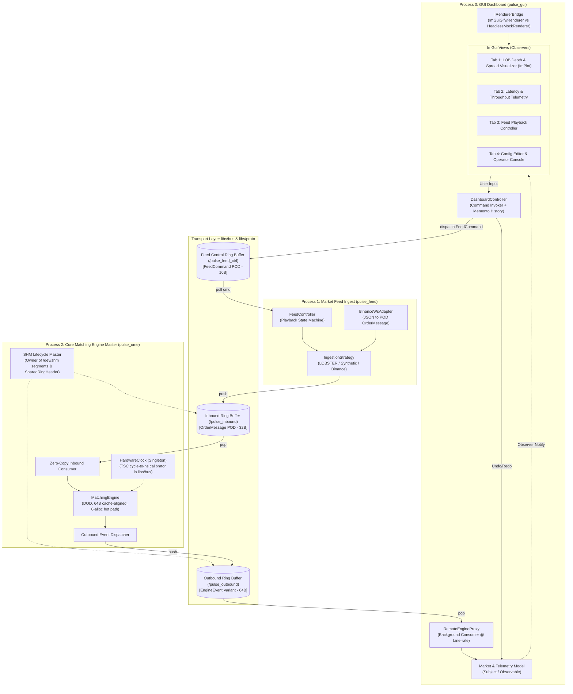

# Technical Implementation Plan: PulseOME Ecosystem for NI-ADP

This document serves as a technical specification and architectural blueprint for transforming **PulseOME** (a low-latency C++23 order matching engine) into a modular exchange ecosystem fulfilling all requirements of the **NI-ADP** (Advanced Design Patterns) course at FIT CTU.

---

## 1. Architectural Overview & Component Decomposition

The system is decomposed into **4 decoupled components** interacting over lock-free SPSC ring buffers with strict process, memory, and thread isolation:



---

## 2. Memory Architecture & IPC Protocol

### 2.1 POSIX Shared Memory Topology & Lifecycle Ownership
- **OME as Core Master:** `pulse_ome` acts as the master of the exchange infrastructure.
  - On startup: pre-cleans stale segments via `shm_unlink`, creates segments (`/pulse_inbound`, `/pulse_outbound`) using `shm_open(O_CREAT | O_RDWR, 0666)`, pre-faults pages, and locks physical RAM via `mlock()` to eliminate page faults.
  - Populates the `SharedRingHeader` metadata block.
  - On clean shutdown: gracefully transitions state to `Stopping` and unlinks shared memory segments.
- **Client Attachment (Feed & GUI):**
  - Clients attach via `shm_open(O_RDWR)` without `O_CREAT`.
  - Validate `magic` number (`0x50554C53`), ABI version, and verify `engineState == EngineState::Running`.
  - Monitor `heartbeatCycles` to detect engine stalls or sudden crashes without polling syscalls.

```
┌────────────────────────────────────────────────────────────────────────┐
│ alignas(64) SharedRingHeader                                           │
│   - uint32_t magic = 0x50554C53 ("PULSE")                              │
│   - uint32_t version = 1                                               │
│   - std::atomic<EngineState> state (Starting, Running, Stopping)       │
│   - std::atomic<uint64_t> heartbeatCycles                              │
├────────────────────────────────────────────────────────────────────────┤
│ alignas(64) std::atomic<uint64_t> writeIndex                           │
├────────────────────────────────────────────────────────────────────────┤
│ alignas(64) std::atomic<uint64_t> readIndex                            │
├────────────────────────────────────────────────────────────────────────┤
│ alignas(64) Slot buffer[Capacity]                                      │
└────────────────────────────────────────────────────────────────────────┘
```

### 2.2 SPSC Lock-Free Ring Buffer Mechanics (`libs/bus/`)
- **Variant:** Single-Producer Single-Consumer (SPSC) ring buffer with power-of-two capacity for fast bitwise masking (`index & (Capacity - 1)`).
- **Zero Cache-Line Contention:** `writeIndex` and `readIndex` are isolated on independent 64-byte cache lines (`alignas(64)`) to completely prevent false sharing between CPU cores.
- **Memory Ordering:**
  - Producer writes slot payload first, then publishes via `writeIndex.store(val, std::memory_order_release)`.
  - Consumer acquires index via `writeIndex.load(std::memory_order_acquire)`, reads slot payload, then publishes via `readIndex.store(val, std::memory_order_release)`.
  - Zero mutexes, zero spinlock overhead, sub-15 ns message delivery.
- **Backpressure Policy:**
  - When Inbound Ring is full, `pulse_feed` blocks without dropping messages to guarantee strict causal consistency for L3 order book replays.
  - Wait strategy: 2-stage backpressure (tight loop with `_mm_pause()` for initial cycles, followed by `std::this_thread::yield()`).

### 2.3 Binary Protocol Definitions (`libs/proto/`)
All structs are flat, trivially copyable Plain Old Data (POD) enforcing `std::is_trivially_copyable_v` and `std::is_standard_layout_v`:

1. **`Types.hpp`:**
   - Primitive aliases: `Timestamp`, `OrderId`, `TradeId`, `Price`, `Quantity` (`uint64_t`, `uint32_t`).
   - `OrderAction` (`uint8_t` enum: `Invalid=0`, `New=1`, `PartialCancel=2`, `FullCancel=3`, `Execution=4`, `HiddenExecution=5`).
   - `Side` (`int8_t` enum: `Sell=-1`, `Buy=1`).
2. **`Messages.hpp`:**
   - `OrderMessage`: Inbound order POD (32 bytes, cache-aligned). Contains timestamp, orderId, price, quantity, action, side.
3. **`Events.hpp`:**
   - `TradeEvent` (48 B): Executed match details (timestamp, tradeId, makerOrderId, takerOrderId, price, quantity, takerSide).
   - `BookDepthEvent` (24 B): Aggregated level update for GUI depth walls (timestamp, price, totalQuantity, side, levelIndex).
   - `LatencyTelemetryEvent` (24 B): Engine execution latency (timestamp, orderId, engineCycles).
   - `EngineStatusEvent` (24 B): Periodic engine health and metrics (timestamp, sequenceNumber, ringOccupancy, engineState).
   - **`EngineEvent` Variant (64 B):**
     `using EngineEvent = std::variant<TradeEvent, BookDepthEvent, LatencyTelemetryEvent, EngineStatusEvent>;`
     Padded and aligned to 64 bytes (`alignas(64)`), ensuring each slot in the Outbound Ring maps to exactly one CPU cache line. Dispatched via **Visitor** pattern in consumers.
4. **`Commands.hpp`:**
   - `FeedCommand` (16 B): Control message sent over `/pulse_feed_ctrl` (Play, Pause, Step, Stop, SetSpeed, ChangeStrategy).

---

## 3. Design Patterns Specification (14 Patterns)

All 14 object-oriented patterns are deployed in supporting subsystems (GUI, Feed, Bus) without compromising the critical path of the matching engine:

### 3.1 Core Mandatory Patterns (11 Patterns)
| # | Pattern | Component / Concrete Classes | Practical Justification |
|---|---|---|---|
| 1 | **MVC** | `gui::Model`, `gui::*View`, `gui::DashboardController` | Decouples local market state cache from ImGui immediate-mode rendering and operator input handling. |
| 2 | **Strategy** | `feed::IngestionStrategy`, `LobsterReplayStrategy`, `SyntheticGeneratorStrategy`, `BinanceLiveStrategy` | Runtime-pluggable market data ingestion algorithms (historical NASDAQ replay vs synthetic random walk vs live exchange stream). |
| 3 | **Bridge** | `gui::IRendererBridge`, `ImGuiGlfwRenderer`, `HeadlessMockRenderer` | Decouples GUI presentation logic from the concrete rendering backend, enabling headless automated testing in CI without an X11/Wayland display server. |
| 4 | **Proxy** | `gui::RemoteEngineProxy` (implements `IEngineService`) | Represents the remote OME process. Drains the outbound ring at line-rate on a worker thread, throttles GUI updates to 60 FPS, and validates commands. |
| 5 | **State** | `feed::PlaybackState` (`StoppedState`, `PlayingState`, `PausedState`, `SteppingState`) | Manages the lifecycle of market data generation and event stepping with deterministic state transitions. |
| 6 | **Visitor** | `telemetry::EventVisitor`, `MetricsAggregatorVisitor`, `OrderBookUpdateVisitor`, `JsonExportVisitor` | Type-safe polymorphic traversal over heterogeneous flat POD events (`EngineEvent` variant) without virtual methods in event structs. |
| 7 | **Observer** | `gui::IModelObserver`, `gui::Model` | Model acts as Subject, notifying subscribed tabs/widgets whenever a new aggregated tick or snapshot is ingested. |
| 8 | **Command** | `gui::ICommand`, `ChangeConfigCommand`, `PlaceManualOrderCommand`, `PauseFeedCommand`, `StepFeedCommand` | Encapsulates operator actions and parameter updates into first-class objects for uniform execution, audit logging, and reversal. |
| 9 | **Memento** | `core::ConfigMemento`, `gui::CommandHistory` | Captures engine/feed configuration snapshots to provide full **Undo/Redo** functionality (`Ctrl+Z` / `Ctrl+Y`) in the operator configuration tab. |
| 10 | **Abstract Factory** | `transport::TransportFactory`, `ShmTransportFactory`, `InProcessTransportFactory` | Instantiates coherent channel families (POSIX Shared Memory `/dev/shm` for production deployment vs In-Process ring buffers for fast unit testing). |
| 11 | **Singleton** | `bus::HardwareClock` (in `libs/bus/include/bus/HardwareClock.hpp`) | Globally accessible processor cycle calibrator (`rdtsc`) providing sub-nanosecond timestamp conversion with zero syscall overhead. |

### 3.2 Bonus Patterns (3 Patterns)
| # | Pattern | Component / Concrete Classes | Practical Justification |
|---|---|---|---|
| 12 | **Adapter** | `feed::BinanceWsAdapter` | Adapts external JSON WebSocket payloads from Binance API into normalized internal `proto::OrderMessage` POD structures. |
| 13 | **Decorator** | `bus::LatencyMeasuringChannelDecorator<T>` | Transparently wraps transport channels to measure and log queue residence time and backpressure delay without modifying core ring buffer code. |
| 14 | **Builder** | `test::OrderScenarioBuilder` | Fluent builder interface for composing deterministic multi-order market test scenarios for unit test suites. |

---

## 4. Component Details & Internal Mechanics

### 4.1 `libs/bus/` (Lock-Free Inter-Process & Inter-Thread Transport)
- **`RingBuffer<T, Capacity>`:** Template lock-free SPSC circular queue with cache-line padding and acquire/release barriers.
- **`ITransportChannel<T>`:** Abstract transport interface exposing `bool push(const T&)` and `bool pop(T&)`.
- **`ShmTransportChannel<T>`:** RAII wrapper managing POSIX shared memory segments (`shm_open`, `ftruncate`, `mmap`, `munmap`, `shm_unlink`).
- **`InProcessTransportChannel<T>`:** Heap-backed memory channel for unit tests and local execution.
- **`HardwareClock` (Singleton):** CPU TSC cycle-to-nanosecond calibration utility, placed in `libs/bus` so all components (OME, Feed, GUI, Bus Decorator) can consume it without circular dependencies.
- **`LatencyMeasuringChannelDecorator<T>`:** Decorator measuring push latency (backpressure) and pop latency (drain rate).

### 4.2 `apps/feed/` (Market Data Ingestion Service - `pulse_feed`)
- Standalone executable binary `pulse_feed`.
- **`FeedController`:** Coordinates playback state machine, active ingestion strategy, and outbound channel.
- Polls non-blocking `pulse_feed_ctrl` ring buffer to execute operator commands (`Play`, `Pause`, `Step`, `Stop`, `SetSpeed`, `ChangeStrategy`).
- Integrates `LobsterReplayStrategy`, `SyntheticGeneratorStrategy`, and `BinanceWsAdapter` with `BinanceLiveStrategy`.

### 4.3 `apps/ome/` (Core Order Matching Engine - `pulse_ome`)
- Standalone executable binary `pulse_ome`.
- Stripped of batch file I/O; converted into an event-driven daemon running on an isolated CPU core.
- Consumes `OrderMessage` from `/pulse_inbound`, matches against 32-byte cache-aligned `OrderBook`, and publishes execution events (`EngineEvent`) to `/pulse_outbound`.
- Memory locking via `mlockall(MCL_CURRENT | MCL_FUTURE)` and optional thread affinity (`pthread_setaffinity_np`).

### 4.4 `apps/gui/` (Interactive ImGui + ImPlot Dashboard - `pulse_gui`)
- Standalone executable binary `pulse_gui`.
- **`RemoteEngineProxy`:** Background worker thread continuously draining `/pulse_outbound` at line-rate. Aggregates data into a double-buffered local model and throttles UI refresh to 60 FPS.
- **`IRendererBridge`:**
  - `ImGuiGlfwRenderer`: Hardware-accelerated OpenGL3 + GLFW backend for interactive use.
  - `HeadlessMockRenderer`: Mock graphics backend enabling CI/CD automated test runs without an X11/Wayland display server.
- **UI Tab Layout:**
  1. *LOB Visualizer:* Interactive real-time bid/ask depth walls and spread histogram using Dear ImPlot.
  2. *Telemetry & Metrics:* Real-time latency distribution curves (p50, p90, p99) and message throughput meters.
  3. *Feed Controller:* Play, Pause, Single-Step controls, speed multiplier slider, and data source selector.
  4. *Config & Operator:* Engine parameter editor with Undo/Redo buttons (`Ctrl+Z` / `Ctrl+Y`), plus manual test order entry form.

---

## 5. Verification and Testing Plan

Mandatory testing with Google Test & Google Mock (headless CI compliant):

1. **`tests/unit/ProtoTest.cpp`:**
   - Validates memory layout, alignment, `sizeof` guarantees, and `std::is_trivially_copyable_v` on all proto structs.
2. **`tests/unit/BusChannelTest.cpp`:**
   - Multi-threaded SPSC ring buffer verification ensuring zero message loss and proper memory ordering.
   - Tests `InProcessTransportChannel` and `LatencyMeasuringChannelDecorator`.
3. **`tests/unit/FeedStateMachineTest.cpp`:**
   - Validates state transitions (`Playing` $\to$ `Paused` $\to$ `Stepping` $\to$ `Stopped`).
   - Mocks `ITransportChannel` using **GMock** to verify exact message emission sequences without opening OS shared memory.
4. **`tests/unit/GuiCommandMementoTest.cpp`:**
   - Validates command invocation, parameter rollback via `ConfigMemento`, and redo operations.
   - Mocks `IEngineProxy` and `IRendererBridge` using **GMock** to run entirely headless.
5. **`tests/unit/EventVisitorTest.cpp`:**
   - Validates polymorphic event traversal over heterogeneous `EngineEvent` variant streams.
6. **`tests/integration/HeadlessPipelineTest.cpp`:**
   - End-to-end integration test chaining Feed $\to$ In-Process Bus $\to$ OME $\to$ GUI Model to ensure zero message loss across 100,000 orders.

---

## 6. Implementation Roadmap & Progress Tracker

### Monorepo Infrastructure
- [x] **Directory Layout Restructuring:** Reorganize root directory into `apps/` (`ome/`, `feed/`, `gui/`), `libs/` (`bus/`, `proto/`), `tests/`, and `benchmarks/`.
- [x] **Modern Target-Based CMake:** Setup top-level and subdirectory `CMakeLists.txt` with target aliases (`pulse::bus`, `pulse::proto`), strict compiler flags, and `FetchContent`.
- [x] **CI/CD Pipeline Setup:** Configure GitHub Actions workflow (`.github/workflows/ci.yml`) with GCC 15, zero-warning policy, automated test execution, and format check.
- [x] **Documentation Update:** Update `README.md` to reflect the new monorepo structure, build instructions, and testing commands.

### `libs/proto/` (Binary Protocol Library)
- [x] **Type Definitions:** Implement `libs/proto/include/proto/Types.hpp` with `OrderAction`, `Side`, and primitive aliases.
- [x] **Inbound Messages:** Update `libs/proto/include/proto/Messages.hpp` (`OrderMessage` POD with `OrderAction action`).
- [x] **Outbound Events:** Implement `libs/proto/include/proto/Events.hpp` (`TradeEvent`, `BookDepthEvent`, `LatencyTelemetryEvent`, `EngineStatusEvent`, and 64B cache-aligned `EngineEvent` variant).
- [x] **Control Commands:** Implement `libs/proto/include/proto/Commands.hpp` (`FeedCommand` POD).
- [x] **Static Assert Verifications:** Add compile-time `is_trivially_copyable` and `sizeof` assertions across all headers.

### `libs/bus/` (Lock-Free Transport Library)
- [ ] **Lock-Free SPSC Ring Buffer:** Implement cache-line padded (`alignas(64)`), zero-allocation `RingBuffer<T, Capacity>`.
- [ ] **Shared Ring Layout & Header:** Implement `SharedRingHeader` with magic number, version, engine state, and heartbeat.
- [ ] **Transport Abstraction:** Implement `ITransportChannel<T>` interface and `InProcessTransportChannel<T>`.
- [ ] **POSIX Shared Memory Transport:** Implement `ShmTransportChannel<T>` using `shm_open`, `ftruncate`, `mmap`, and `munmap`.
- [ ] **Hardware Clock Singleton:** Implement `HardwareClock` (**Singleton** pattern) in `libs/bus/include/bus/HardwareClock.hpp` for CPU TSC cycle-to-nanosecond calibration.
- [ ] **Channel Decorator:** Implement `LatencyMeasuringChannelDecorator<T>` (**Decorator** pattern) for queue and backpressure profiling.
- [ ] **Transport Abstract Factory:** Implement `TransportFactory`, `ShmTransportFactory`, and `InProcessTransportFactory` (**Abstract Factory** pattern).
- [ ] **Unit Tests for Bus:** Multi-threaded stress tests verifying lock-free concurrency and zero message loss.

### `apps/feed/` (Market Feed Ingestion Service)
- [ ] **Component Migration:** Move `OrderGenerator` and `LobsterOrderLoader` from core engine into `apps/feed/`.
- [ ] **Ingestion Strategy:** Define `IngestionStrategy` interface and implement `LobsterReplayStrategy` and `SyntheticGeneratorStrategy` (**Strategy** pattern).
- [ ] **Binance Live Adapter:** Implement `BinanceWsAdapter` (**Adapter** pattern) and `BinanceLiveStrategy` for live WebSocket market data streaming.
- [ ] **Playback State Machine:** Implement `PlaybackState` finite state machine (**State** pattern: `StoppedState`, `PlayingState`, `PausedState`, `SteppingState`).
- [ ] **Feed Controller:** Implement `FeedController` coordinating strategies, playback states, control ring polling, and the outbound SPSC channel.
- [ ] **Feed Binary Entrypoint:** Implement `apps/feed/src/main.cpp` (`pulse_feed`) with CLI argument parsing.
- [ ] **Feed Unit Tests with GMock:** Implement `tests/unit/FeedStateMachineTest.cpp` mocking `ITransportChannel` via **GMock**.

### `apps/ome/` (Matching Engine Service)
- [ ] **Engine Isolation:** Isolate core matching engine inside `apps/ome/`, stripping out batch I/O and CSV dependencies.
- [ ] **SHM Master Integration:** Implement initialization and cleanup of `/pulse_inbound` and `/pulse_outbound` segments in `pulse_ome`.
- [ ] **Continuous Event Loop:** Implement continuous zero-allocation matching loop in `apps/ome/` consuming `OrderMessage` from inbound ring and dispatching `EngineEvent` to outbound ring.
- [ ] **OS-Level Isolation:** Preserve and wire up thread affinity pinning (`--cpu`) and memory locking (`--lock-memory`).
- [ ] **Verification:** Ensure existing unit tests, integration tests, and benchmarks compile cleanly and pass against the refactored OME engine.

### `apps/gui/` (Interactive ImGui Dashboard)
- [ ] **Dependency Integration:** Integrate Dear ImGui, ImPlot, and GLFW/OpenGL3 via `FetchContent` with `SYSTEM` includes.
- [ ] **Renderer Bridge:** Implement `IRendererBridge` (**Bridge** pattern), `ImGuiGlfwRenderer` for OpenGL window, and `HeadlessMockRenderer` for automated testing.
- [ ] **Remote Engine Proxy:** Implement `RemoteEngineProxy` (**Proxy** pattern) running a background consumer thread draining the outbound ring buffer and updating the local model.
- [ ] **MVC Architecture:**
  - [ ] **Model:** Thread-safe double-buffered local cache of order book levels, trade tape, and telemetry.
  - [ ] **Observer Subject:** Implement `IModelObserver` and notification mechanism (**Observer** pattern).
  - [ ] **Visitor Traversal:** Implement `EventVisitor`, `MetricsAggregatorVisitor`, and `OrderBookUpdateVisitor` (**Visitor** pattern).
  - [ ] **Command & Memento:** Implement `ICommand`, `ConfigMemento`, and `CommandHistory` (**Command** and **Memento** patterns) supporting full Undo/Redo (`Ctrl+Z` / `Ctrl+Y`).
  - [ ] **Views (Observers / ImGui Tabs):**
    - [ ] Tab 1: Live interactive LOB Depth Chart & Spread Visualizer (ImPlot).
    - [ ] Tab 2: Latency Histogram (p50, p90, p99) & Message Throughput meters.
    - [ ] Tab 3: Feed Playback Controller (Play, Pause, Step, speed multiplier).
    - [ ] Tab 4: Config Editor with Undo/Redo & Manual Order Entry form.
  - [ ] **Controller:** Implement `DashboardController` orchestrating commands, views, and engine proxy.
- [ ] **GUI Binary Entrypoint:** Implement `apps/gui/src/main.cpp` (`pulse_gui`).

### Final Verification & Defense Preparation
- [ ] **GUI Command & Memento Test:** Implement `tests/unit/GuiCommandMementoTest.cpp` mocking `IEngineProxy` and `IRendererBridge` via **GMock**.
- [ ] **Event Visitor Test:** Implement `tests/unit/EventVisitorTest.cpp` testing polymorphic event handling.
- [ ] **Test Order Builder:** Implement `OrderScenarioBuilder` (**Builder** pattern) for fluent test setup.
- [ ] **Headless Pipeline Test:** Implement `tests/integration/HeadlessPipelineTest.cpp` running Feed $\to$ In-Process Bus $\to$ OME $\to$ GUI Model end-to-end.
- [ ] **Zero-Warning Verification:** Verify clean build under GCC 15 and Clang 18 with `-Wall -Wextra -Wpedantic -Wconversion -Wshadow`.
- [ ] **Defense Readiness:** Prepare demonstration scenarios, verify all 14 design patterns against course criteria, and document benchmarks.
