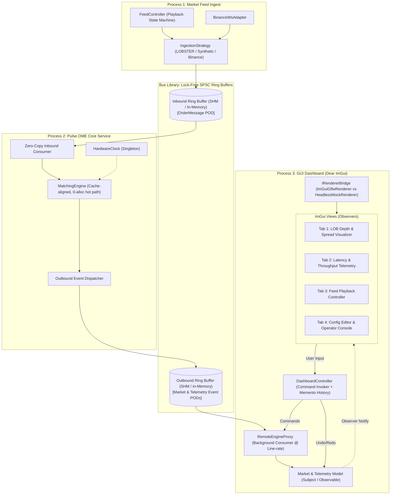

# Technical Implementation Plan: PulseOME Ecosystem for NI-ADP

This document serves as the comprehensive technical specification and execution plan for transforming **PulseOME** (an ultra-low-latency C++23 order matching engine) into a modular 4-component exchange ecosystem fulfilling all requirements of the **NI-ADP** course at FIT CTU.

---

## 1. Architectural Overview & Component Decomposition

The system is split into **4 decoupled components** with strictly defined process and memory boundaries:

---

## 2. Design Patterns Specification (14 Patterns)

All object-oriented patterns are deployed outside the ultra-low-latency hot path (primarily in GUI, Feed, and Bus infrastructure):

### 2.1 Core Mandatory Patterns (11 Patterns)
| # | Pattern | Component / Concrete Classes | Practical Justification |
|---|---|---|---|
| 1 | **MVC** | `gui::Model`, `gui::*View`, `gui::DashboardController` | Strict separation of the local market state cache from ImGui immediate-mode rendering and operator input handling. |
| 2 | **Strategy** | `feed::IngestionStrategy`, `LobsterReplayStrategy`, `SyntheticGeneratorStrategy`, `BinanceLiveStrategy` | Runtime-pluggable market data ingestion algorithms (historical NASDAQ replay vs synthetic random walk vs live exchange stream). |
| 3 | **Bridge** | `gui::IRendererBridge`, `ImGuiGlfwRenderer`, `HeadlessMockRenderer` | Decouples GUI presentation logic from the concrete rendering backend (enabling headless automated testing without an active display server). |
| 4 | **Proxy** | `gui::RemoteEngineProxy` (implements `IEngineService`) | Represents the remote OME process. Drains the outbound ring at line-rate, throttles GUI updates to 60 FPS, and validates commands before dispatch. |
| 5 | **State** | `feed::PlaybackState` (`StoppedState`, `PlayingState`, `PausedState`, `SteppingState`) | Manages the lifecycle of market data generation and event stepping. |
| 6 | **Visitor** | `telemetry::EventVisitor`, `MetricsAggregatorVisitor`, `OrderBookUpdateVisitor`, `JsonExportVisitor` | Type-safe polymorphic traversal over heterogeneous flat POD events (`TradeEvent`, `BookDepthEvent`, `LatencyTelemetryEvent`) without adding virtual methods to the structs. |
| 7 | **Observer** | `gui::IModelObserver`, `gui::Model` | Model acts as Subject, notifying subscribed tabs/widgets whenever a new aggregated tick or snapshot is ingested. |
| 8 | **Command** | `gui::ICommand`, `ChangeConfigCommand`, `PlaceManualOrderCommand`, `PauseFeedCommand` | Encapsulates operator actions and parameter updates into first-class objects for uniform execution, audit logging, and reversal. |
| 9 | **Memento** | `core::ConfigMemento`, `gui::CommandHistory` | Captures engine/feed configuration snapshots to provide full **Undo/Redo** functionality (`Ctrl+Z` / `Ctrl+Y`) in the operator configuration tab. |
| 10 | **Abstract Factory** | `transport::TransportFactory`, `ShmTransportFactory`, `InProcessTransportFactory` | Instantiates coherent channel families (POSIX Shared Memory `/dev/shm` for production deployment vs In-Process ring buffers for fast unit testing). |
| 11 | **Singleton** | `telemetry::HardwareClock` | Globally accessible processor cycle calibrator (`rdtsc`) providing sub-nanosecond timestamp conversion with zero syscall overhead. |

### 2.2 Bonus Patterns (3 Patterns)
| # | Pattern | Component / Concrete Classes | Practical Justification |
|---|---|---|---|
| 12 | **Adapter** | `feed::BinanceWsAdapter` | Adapts external JSON WebSocket payloads from Binance API into normalized internal `engine::OrderMessage` POD structures. |
| 13 | **Decorator** | `bus::LatencyMeasuringChannelDecorator` | Transparently wraps transport channels to measure and log queue residence time without modifying core ring buffer code. |
| 14 | **Builder** | `test::OrderScenarioBuilder` | Fluent builder interface for composing deterministic multi-order market test scenarios for unit test suites. |

---

## 3. Detailed Component Architecture

### 3.1 `libs/bus/` (Inter-Process & Inter-Thread Transport Library - `pulse::bus`)
- **`RingBuffer<T, Capacity>`:** Template lock-free single-producer single-consumer (SPSC) ring buffer. Cache-line padded (64 bytes) to eliminate false sharing, using `acquire`/`release` memory barriers and zero runtime allocations.
- **`ITransportChannel<T>`:** Abstract transport interface with `push(const T&)` and `pop(T&)`.
- **`ShmTransportChannel<T>`:** Backed by POSIX Shared Memory (`shm_open`, `ftruncate`, `mmap`).
- **`InProcessTransportChannel<T>`:** Heap-backed memory channel for unit tests and local execution.
- **`Events.hpp`:** Flat binary POD outbound event representations:
  - `TradeEvent` (executed trade: price, quantity, timestamp, trade ID)
  - `BookDepthEvent` (level update: price, quantity, side)
  - `LatencyTelemetryEvent` (engine cycle count / nanosecond latency tick)
  - `EngineStatusEvent` (ring occupancy, queue drops, heartbeat)

### 3.2 `apps/feed/` (Market Ingestion & Playback Service - `pulse::feed`)
- Standalone executable binary `pulse_feed`.
- **`FeedController`:** Manages playback lifecycle, holding an active `IngestionStrategy` and `PlaybackState`.
- **`IngestionStrategy` implementations:**
  - `LobsterReplayStrategy`: Reads historical NASDAQ order books from CSV files.
  - `SyntheticGeneratorStrategy`: Parametric random-walk generator for stress testing.
  - `BinanceLiveStrategy`: Live cryptocurrency market data ingest via WebSocket client.
- **`PlaybackState` transitions:**
  - `play()`, `pause()`, `step()`, `stop()`.

### 3.3 `apps/ome/` (Order Matching Engine Service - `pulse::ome`)
- Standalone executable binary `pulse_ome` containing the core matching engine.
- Stripped of batch I/O and disk operations; transformed into a continuous event-driven daemon.
- Single pinned worker thread consuming `OrderMessage` from `InboundRing`, matching against the 32-byte cache-aligned `OrderBook`, and emitting execution events into `OutboundRing`.
- Calibrated by `HardwareClock::instance()`.

### 3.4 `apps/gui/` (Interactive ImGui + ImPlot Dashboard - `pulse::gui`)
- Standalone executable binary `pulse_gui`.
- **`IRendererBridge`:**
  - `ImGuiGlfwRenderer`: Hardware-accelerated OpenGL3 + GLFW backend.
  - `HeadlessMockRenderer`: Mock graphics backend enabling CI/CD automated test runs without an X11/Wayland display.
- **`RemoteEngineProxy`:** Dedicated background worker thread continuously draining `OutboundRing` into double-buffered local model.
- **UI Tab Layout:**
  1. *LOB Visualizer:* Interactive real-time bid/ask depth walls and spread histogram using Dear ImPlot.
  2. *Telemetry & Metrics:* Real-time latency distribution curves (p50, p90, p99) and message throughput meters.
  3. *Feed Controller:* Play, Pause, Single-Step controls, speed multiplier slider, and data source selector.
  4. *Config & Operator:* Engine parameter editor with Undo/Redo buttons (`Ctrl+Z`), plus manual test order entry form.

---

## 4. Verification and Testing Plan

The assignment mandates $\ge 5$ unit tests across $\ge 2$ suites with mocking. We implement 3 comprehensive suites with Google Test & Google Mock:

1. **`tests/unit/FeedStateMachineTest.cpp`:**
   - Validates state transitions (`Playing` $\to$ `Paused` $\to$ `Stepping` $\to$ `Stopped`).
   - Mocks `ITransportChannel` using **GMock** to verify exact message emission sequences without opening OS memory.
2. **`tests/unit/GuiCommandMementoTest.cpp`:**
   - Validates command invocation, parameter rollback via `ConfigMemento`, and redo operations.
   - Mocks `IEngineProxy` and `IRendererBridge` using **GMock** to run entirely headless.
3. **`tests/unit/EventVisitorTest.cpp`:**
   - Validates polymorphic event traversal over heterogeneous outbound event streams.
4. **`tests/integration/HeadlessPipelineTest.cpp`:**
   - End-to-end integration test chaining Feed $\to$ In-Process Bus $\to$ OME $\to$ GUI Model to ensure zero message loss across 100,000 orders.

---

## 5. Implementation Roadmap & Progress Tracker

### Milestone 0: Monorepo
- [x] **Directory Layout Restructuring:** Reorganize root directory into `apps/` (`ome/`, `feed/`, `gui/`), `libs/` (`bus/`), `tests/`, and `benchmarks/`.
- [x] **Modern Target-Based CMake:** Setup top-level and subdirectory `CMakeLists.txt` with target aliases (`pulse::bus`), strict compiler flags, and `FetchContent`.
- [x] **CI/CD Pipeline Setup:** Configure GitHub Actions workflow (`.github/workflows/ci.yml`) with GCC 15, zero-warning policy, automated test execution and format check
- [x] **Documentation Update:** Update `README.md` to reflect the new monorepo structure, build instructions, and testing commands.

### Milestone 1: `libs/bus/` Subsystem
- [ ] **Lock-Free SPSC Ring Buffer:** Implement cache-line padded (`alignas(64)`), zero-allocation `RingBuffer<T, Capacity>` in `libs/bus/`.
- [ ] **Transport Abstraction:** Implement `ITransportChannel<T>` interface and `InProcessTransportChannel<T>`.
- [ ] **POSIX Shared Memory Transport:** Implement `ShmTransportChannel<T>` using `shm_open`, `ftruncate`, and `mmap`.
- [ ] **Transport Abstract Factory:** Implement `TransportFactory`, `ShmTransportFactory`, and `InProcessTransportFactory` (**Abstract Factory** pattern).
- [ ] **Channel Decorator:** Implement `LatencyMeasuringChannelDecorator<T>` (**Decorator** pattern) for queue profiling.
- [ ] **Event Definitions:** Define flat POD structs in `libs/bus/include/bus/Events.hpp` (`TradeEvent`, `BookDepthEvent`, `LatencyTelemetryEvent`, `EngineStatusEvent`).
- [ ] **Unit Tests for Bus:** Comprehensive test suite for ring buffers and transport channels.

### Milestone 2: `apps/feed/` Subsystem
- [ ] **Component Migration:** Move `OrderGenerator` and `LobsterOrderLoader` from the core engine into `apps/feed/`.
- [ ] **Ingestion Strategy:** Define `IngestionStrategy` interface and implement `LobsterReplayStrategy` and `SyntheticGeneratorStrategy` (**Strategy** pattern).
- [ ] **Binance Live Adapter:** Implement `BinanceWsAdapter` (**Adapter** pattern) and `BinanceLiveStrategy` for live WebSocket market data streaming.
- [ ] **Playback State Machine:** Implement `PlaybackState` finite state machine (**State** pattern: `StoppedState`, `PlayingState`, `PausedState`, `SteppingState`).
- [ ] **Feed Controller:** Implement `FeedController` coordinating strategies, playback states, and the outbound SPSC channel.
- [ ] **Feed Binary Entrypoint:** Implement `apps/feed/src/main.cpp` (`pulse_feed`) with CLI argument parsing.
- [ ] **Feed Unit Tests with GMock:** Implement `tests/unit/FeedStateMachineTest.cpp` mocking `ITransportChannel` via **GMock**.

### Milestone 3: `apps/ome/` Hardening
- [ ] **Engine Isolation:** Isolate core matching engine inside `apps/ome/`, stripping out batch I/O and CSV dependencies.
- [ ] **Hardware Clock Singleton:** Implement `HardwareClock` (**Singleton** pattern) for CPU TSC cycle-to-nanosecond calibration.
- [ ] **Continuous Event Loop:** Implement continuous zero-allocation matching loop in `apps/ome/` consuming `OrderMessage` from inbound ring and dispatching events to outbound ring.
- [ ] **OS-Level Isolation:** Preserve and wire up thread affinity pinning (`--cpu`) and memory locking (`--lock-memory`).
- [ ] **Verification:** Ensure existing unit tests, integration tests, and benchmarks compile cleanly and pass against the OME engine.

### Milestone 4: `apps/gui/` Dashboard (Dear ImGui & ImPlot)
- [ ] **Dependency Integration:** Integrate Dear ImGui, ImPlot, and GLFW/OpenGL3 via `FetchContent` with `SYSTEM` includes.
- [ ] **Renderer Bridge:** Implement `IRendererBridge` (**Bridge** pattern), `ImGuiGlfwRenderer` for OpenGL window, and `HeadlessMockRenderer` for automated testing.
- [ ] **Remote Engine Proxy:** Implement `RemoteEngineProxy` (**Proxy** pattern) running a background consumer thread draining the outbound ring buffer and updating the local model.
- [ ] **MVC Architecture:**
  - [ ] **Model:** Thread-safe double-buffered local cache of order book levels, trade tape, and telemetry.
  - [ ] **Observer Subject:** Implement `IModelObserver` and notification mechanism (**Observer** pattern).
  - [ ] **Visitor Traversal:** Implement `EventVisitor`, `MetricsAggregatorVisitor`, and `OrderBookUpdateVisitor` (**Visitor** pattern).
  - [ ] **Command & Memento:** Implement `ICommand`, `ConfigMemento`, and `CommandHistory` (**Command** and **Memento** patterns) supporting full Undo/Redo (`Ctrl+Z` / `Ctrl+Y`).
  - [ ] **Views (Observers / ImGui Tabs):**
    - [ ] Tab 1: Live interactive LOB Depth Chart & Spread Visualizer (ImPlot).
    - [ ] Tab 2: Latency Histogram (p50, p90, p99) & Message Throughput meters.
    - [ ] Tab 3: Feed Playback Controller (Play, Pause, Step, speed multiplier).
    - [ ] Tab 4: Config Editor with Undo/Redo & Manual Order Entry form.
  - [ ] **Controller:** Implement `DashboardController` orchestrating commands, views, and engine proxy.
- [ ] **GUI Binary Entrypoint:** Implement `apps/gui/src/main.cpp` (`pulse_gui`).

### Milestone 5: Unit Testing, Verification & Defense Prep
- [ ] **GUI Command & Memento Test:** Implement `tests/unit/GuiCommandMementoTest.cpp` mocking `IEngineProxy` and `IRendererBridge` via **GMock**.
- [ ] **Event Visitor Test:** Implement `tests/unit/EventVisitorTest.cpp` testing polymorphic event handling.
- [ ] **Test Order Builder:** Implement `OrderScenarioBuilder` (**Builder** pattern) for fluent test setup.
- [ ] **Headless Pipeline Test:** Implement `tests/integration/HeadlessPipelineTest.cpp` running Feed $\to$ In-Process Bus $\to$ OME $\to$ GUI Model end-to-end.
- [ ] **Zero-Warning Verification:** Verify clean build under GCC 15 and Clang 18 with `-Wall -Wextra -Wpedantic -Wconversion -Wshadow`.
- [ ] **Defense Readiness:** Prepare demonstration scenarios, verify all 14 design patterns against course criteria, and document benchmarks.
